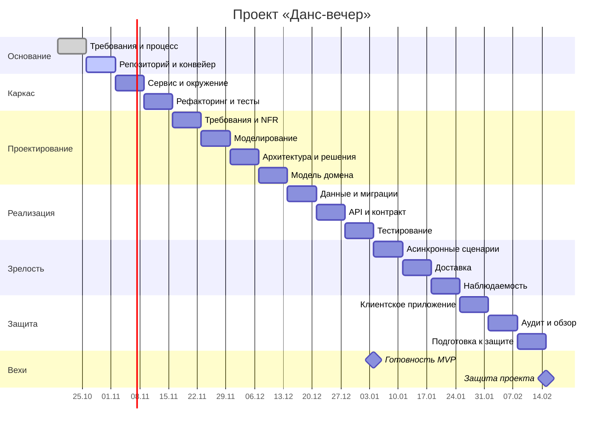

# План семестра — «Данс-вечер»

Планирование от скорости: один модуль курса — одна неделя работы. Задачи внутри
модулей не расписываю по дням — по методичке Гантт показывает порядок и
зависимости, а не обязательства по каждому дню.

**Контрольные точки:**

| Точка | Срок | Критерий прохождения |
|---|---|---|
| Требования утверждены | конец М01 | Домен согласован, MVP и границы зафиксированы |
| Конвейер зелёный | конец М02 | Ветка защищена, проверки проходят |
| Сервис поднимается | конец М03 | Одна команда — работающее окружение |
| MVP работает | конец М11 | Сквозной сценарий проходится целиком |

**Буфер**: 20 % времени каждой вехи заложено на непредвиденное — сессии,
болезни, переделки по ревью. Расход буфера фиксируется в журнале изменений
и разбирается на фикс-часе, а не съедается молча.
