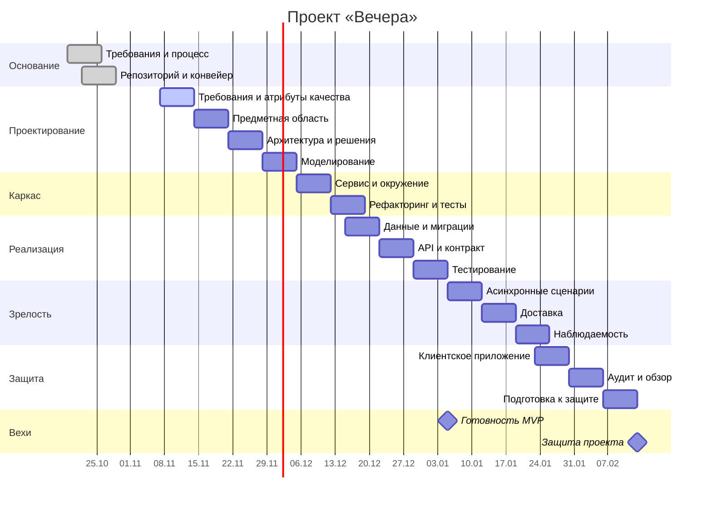

# План семестра — «Вечера»

Планирование от скорости: один модуль курса — одна неделя работы. Задачи внутри
модулей не расписываю по дням — по методичке Гантт показывает порядок и
зависимости, а не обязательства по каждому дню.

Часть работ стартует параллельно, не дожидаясь полного завершения предыдущих:
конвейер репозитория начинается до финальной правки требований; каркас сервиса —
до закрытия моделирования; схема данных — до закрытия модели домена;
клиентское приложение — до завершения наблюдаемости. Перекрытия отмечены
датами старта.

Порядок модулей 03–08 приведён к программе курса (ЛР 2): проектирование
(модули 03–06) идёт **до первой строки кода**, каркас (модули 07–08) — после.
Перенумерация зафиксирована в CHANGELOG, версия 0.3.0.

**Контрольные точки:**

| Точка | Срок | Критерий прохождения | Состояние |
| --- | --- | --- | --- |
| Требования утверждены | конец М01 | Домен согласован, MVP и границы зафиксированы | Пройдена: работа 1 сдана |
| Конвейер зелёный | конец М02 | Ветка защищена, проверки проходят | Пройдена с расходом буфера на неделю: слито 06.11 |
| Сервис поднимается | конец М07 | Одна команда — работающее окружение | — |
| MVP работает | конец М11 | Сквозной сценарий проходится целиком | — |

**Буфер**: 20 % времени каждой вехи заложено на непредвиденное — сессии,
праздники, болезни, переделки по ревью. Перенумерация модулей съела часть
буфера Р1–Р2 (проектирование сдвинулось на две недели против плана работы 1);
расход зафиксирован в журнале изменений и разбирается на фикс-часе, а не
съедается молча.
