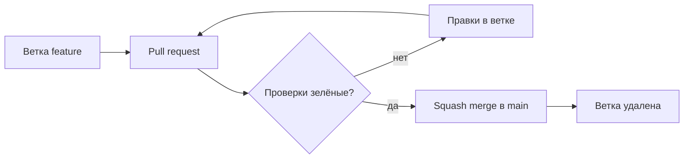

# Конвейер — «Вечера»

## Зачем

Команда из одного человека не получает чужого ревью, поэтому качество main охраняет
конвейер: он читает каждый pull request до того, как изменение попадёт в основную
ветку. Правило простое — main всегда в пригодном состоянии: читаемые документы,
живые ссылки, никаких забытых заглушек.

## Что проверяется

Три независимых задания в [../.github/workflows/checks.yml](../.github/workflows/checks.yml).
Запуск — на каждый pull request и каждый пуш в main; общая длительность около минуты.

| Задание | Инструмент | Что ловит |
| --- | --- | --- |
| Стиль Markdown | markdownlint-cli2 | сломанные таблицы и списки, пробелы в конце строк, дубли заголовков, слишком длинные строки прозы |
| Стиль YAML | yamllint | ошибки синтаксиса и стиля в файлах конвейера |
| Плейсхолдеры и ссылки | [scripts/check_docs.py](../scripts/check_docs.py) | незаполненные остатки и заглушки, битые ссылки на файлы и якоря, CRLF и BOM |



## Локальный запуск

Те же проверки, что в конвейере, — на своей машине до открытия pull request:

```bash
npm install --global markdownlint-cli2
markdownlint-cli2

python3 -m pip install yamllint
yamllint .

python3 scripts/check_docs.py
```

## Ветвление и слияние

- main — единственная долгоживущая ветка, всегда зелёная
- работа идёт в коротких ветках от свежего main: `feature/…`, `docs/…`, `ci/…`, `fix/…`
- слияние — только через pull request и только squash merge: одна задача — один
  коммит в истории
- ветка удаляется после слияния
- сообщения коммитов — Conventional Commits: `docs:`, `ci:`, `feat:`, `fix:`,
  `refactor:`, `test:` — тип изменения виден в истории без открытия diff

## Защита main

Настраивается один раз, после первого зелёного прогона конвейера: имена проверок
появляются в списке, только когда хоть раз отработали.

1. **Settings → Rules → Rulesets → New branch ruleset** (если в аккаунте осталась
   классическая защита веток — те же галочки в Settings → Branches)
2. Цель правила — ветка `main`
3. Включить требования:
   - Require a pull request — approvals не запрашивать: ревью второго человека
     в соло-проекте недоступно, компенсация — саморевью по DoD и конвейер
   - Require status checks to pass — отметить все три: «Стиль Markdown»,
     «Стиль YAML», «Плейсхолдеры и ссылки»
   - Блокировать force push и удаление ветки
4. **Settings → General → Pull Requests**: разрешить только squash merge, остальные
   способы слияния выключить; включить автоматическое удаление ветки после слияния

Проверка настройки: прямая попытка запушить в main должна быть отклонена GitHub.

## Исключения в правилах

Каждое исключение фиксируется здесь вместе с причиной. Исключение без причины
запрещено — это часть соло-дисциплины: конвейер строгий ровно настолько,
насколько ему позволяют быть.

| Правило | Решение | Причина |
| --- | --- | --- |
| MD013, длина строки | 120; таблицы и блоки кода не считаются | строки карт (CJM, USM) длиннее прозы; гантт живёт в блоке кода |
| MD024, дубли заголовков | только среди соседей | «Добавлено» и «Изменено» повторяются в каждой версии CHANGELOG |
| MD036, жирный вместо заголовка | выключено | жирные строки в шаблоне PR и акценты в картах — не заголовки |
| MD041, первая строка — H1 | отключён в .github/.markdownlint-cli2.jsonc | шаблон pull request — служебная форма GitHub, а не документ |
| MD060, стиль таблиц | compact | единый стиль: пробел вокруг содержимого ячеек и в строке разделителей |
| yamllint, длина строки | выключено | команды и ссылки в workflow длинные, длина не критична |
| yamllint, truthy | выключено | ключ `on:` GitHub Actions yamllint считает логическим значением |
| yamllint, document-start | выключено | маркер `---` в начале файла не требуется |

## Что дальше

С М03 в конвейер добавятся сборка и тесты, с М04 — линтер кода: новые задания
лягут отдельными строками в таблицу проверок, структура конвейера не изменится.
