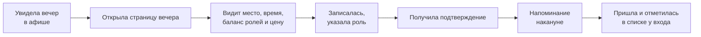

# Требования — «Данс-вечер»

Рабочее название: платформа танцевальных вечеров для города.
Социальные танцы: бачата, сальса, меренге.

## Предметная область

### Проверка домена по четырём требованиям

| Требование | Проверка | Итог |
|---|---|---|
| 2–3 ограниченных контекста | Вечера и заведения · Записи и баланс ролей · Цены · Уведомления | ✅ четыре |
| Внешняя интеграция | Уведомления (email/push), карты, платёжный шлюз (перспектива) | ✅ |
| Пользовательский интерфейс | Афиша и страница вечера для танцора, панель организатора | ✅ |
| Нетривиальные данные | Вечера, записи со статусами, роли, история изменения баланса, заведения, посещаемость | ✅ |

**Вывод**: домен проходит.

## Постановка проблемы

> Танцору в моём городе нужно состоять в 4 пабликах ВК, чтобы узнать, где сегодня бачата.

**Что**: танцевальные вечера живут в ВК-пабликах и чатах. Информация размазана по источникам,
запись — переписка с организатором в личке, баланс ролей (ведущих и ведомых) не виден никому
до самого вечера.

**Для кого**: танцоры социальных танцев города и организаторы-энтузиасты, которые проводят
вечера в барах и ресторанах и ведут всю запись вручную, «на коленке».

**Зачем**: танцор видит все вечера в одной афише и записывается без единого сообщения
организатору; организатор заранее видит список и баланс ролей и может выправить баланс
ценой до вечера, а не обнаружить пустой танцпол на месте.

**Как измерим успех**: доля записей, оформленных без участия организатора, и число вечеров,
собравшихся с балансом ролей не хуже [2:1 — порог уточнить у студий].

## Персоны

### Персона: Постоянная танцорка (ведомая)

**Роль и контекст**: работает, танцует бачату и сальсу 2–3 раза в неделю, ходит на все
социальные вечеринки города.

**Цель**: знать заранее, где вечер, и не приехать на мёртвый танцпол.

**Как решает задачу сейчас**: состоит в четырёх пабликах ВК, мониторит посты вручную,
вечером накануне пишет организатору «кто идёт?».

**Боли**:
- узнаёт о вечере поздно — пост выходит накануне
- не видит баланс ролей до прихода
- на месте может оказаться 15 ведомых на 4 ведущих — вечер испорчен
- отменить запись можно только неловкой перепиской

**Что важно**: увидеть вечер и баланс за минуту; записаться и отменить без переписки;
напоминание накануне.

### Персона: Организатор вечеров

**Роль и контекст**: фанат танцев, организует 1–2 вечеринки в месяц в баре, совмещает
с основной работой, всё делает сам.

**Цель**: собрать полный зал без ручной работы и спасти баланс ролей.

**Как решает задачу сейчас**: пост в ВК + чат + таблица, вручную считает запись,
отвечает на одни и те же вопросы в личке.

**Боли**:
- ручной подсчёт записавшихся
- перекос ролей обнаруживается только на месте
- одни и те же вопросы в личке вместо работы
- владельцу бара нечего показать: посещаемость нигде не фиксируется

**Что важно**: список записавшихся собирается сам; баланс ролей виден заранее;
инструмент выправления баланса до вечера; цифры посещаемости для заведения.

## Путь пользователя

Персона: Постоянная танцорка
Сценарий: записаться на вечер

1. **Увидела вечер** — в единой афише города, не в четырёх пабликах
2. **Открыла страницу вечера** — место, время, цена, программа
3. **Оценила баланс** — сколько записалось ведущих и ведомых
4. **Записалась** — указала свою роль, без переписки
5. **Получила подтверждение** — запись видна в профиле
6. **Получила напоминание** — накануне вечером
7. **Пришла и отметилась** — имя в списке у организатора

Отдельный сценарий «отмена»: планы изменились → открыла запись → отменила → место освободилось.

## Минимально жизнеспособный продукт

Входит:
- Единая афиша танцевальных вечеров города
- Страница вечера: место, время, цена, программа
- Запись на вечер с указанием роли (ведущий / ведомая)
- Видимый баланс ролей на странице вечера
- Динамическая цена для дефицитной роли — расчёт и отображение (оплата на месте)
- Список записавшихся для организатора
- Отмена своей записи

Критерий: танцор проходит сценарий «увидела → записалась → пришла → отметилась →
при необходимости отменила» без единого сообщения организатору; организатор видит
список и баланс без ручного подсчёта.

Принцип: система не существует на танцполе. Всё взаимодействие — до входа и после выхода.
На самом мероприятии продукта нет.

## Вне области охвата этого семестра

| Не делаем | Почему |
|---|---|
| Онлайн-оплата | Требует договора с платёжным шлюзом; для проверки гипотезы достаточно оплаты на месте |
| Мобильное приложение | Веб-версия закрывает сценарий; нативный клиент — отдельный объём |
| Цифровой инвайт на танец | Нарушает принцип «на танцполе продукта не существует»; выходит за рамки семестра |
| Запросы диджею | Удобство, а не необходимость для проверки гипотезы |
| «Сохранить танец» (история партнёрств) | Требует накопленной истории посещений; на старте данных нет |
| Несколько городов | Усложняет модель и афишу, не влияет на проверяемую гипотезу |
