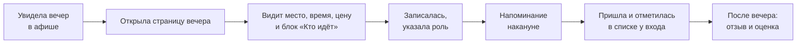

# Требования — «Вечера»

Рабочее название: платформа городских вечеров — афиша, запись и обратная связь.
Категории: танцевальные вечера (бачата, сальса, меренге), стэндап, квизы, концерты,
настольные игры. Первый и самый проработанный сценарий — танцевальные вечера:
у них собственная логика ролей, которой нет у других категорий.

Идентификаторы требований (`FR-NN`, `NFR-NN`, `BR-NN`, `C-NN`) присваиваются навсегда
и не переиспользуются. На них ссылаются модель предметной области
([domain/](domain/)), записи о решениях ([adr/](adr/)) и матрица
прослеживаемости ([traceability.md](traceability.md)).

## Предметная область

| Требование к домену | Проверка | Итог |
| --- | --- | --- |
| 2–3 ограниченных контекста | Вечера и записи · Отзывы и репутация · Учёт участников; Уведомления — общий узел (выведены заново в ЛР 2Б) | ✅ |
| Внешняя интеграция | Почтовый сервер (уведомления); карты и платёжный шлюз — перспектива вне охвата | ✅ |
| Пользовательский интерфейс | Афиша и страница вечера для посетителя, панель организатора | ✅ |
| Нетривиальные данные | Вечера разных категорий, записи со статусами, роли, цены, отзывы, история посещаемости | ✅ |

**Вывод**: домен проходит. Границы контекстов пересмотрены в ЛР 2Б по значению
слов — см. [domain/event-storming.md](domain/event-storming.md).

## Постановка проблемы

> Танцору в моём городе нужно состоять в 4 пабликах ВК, чтобы узнать, где сегодня бачата.

**Что**: городские вечера — танцы, стэндап, квизы — живут в ВК-пабликах и чатах.
Информация размазана по источникам, запись — переписка с организатором в личке,
состав участников не виден никому до самого вечера, а после вечера всё исчезает:
ни отзывов, ни фото, ни понимания, стоит ли идти в следующий раз.

**Для кого**: посетители городских вечеров и организаторы-энтузиасты, которые проводят
вечера в барах и ресторанах и ведут всю запись вручную.

**Зачем**: посетитель видит все вечера в одной афише, записывается без переписки
и видит, кто ещё идёт; организатор заранее видит список и состав, а после вечера
получает отзывы и фотоотчёт — витрину для следующих вечеров.

**Как измерим**: доля записей, оформленных без участия организатора (`BR-01`);
доля вечеров со видимым составом (`BR-02`); доля танцевальных вечеров без
критического перекоса ролей (`BR-03`).

## Заинтересованные стороны

| Сторона | Кто это у нас | Интерес | Требования |
| --- | --- | --- | --- |
| Пользователь | Посетитель вечеров (персона «Постоянная танцорка») | Найти вечер, увидеть состав, записаться и отменить без переписки | `FR-01`, `FR-02`, `FR-04`–`FR-07`, `FR-09`, `FR-10`–`FR-12`, `NFR-01` |
| Оператор | Организатор вечеров (персона «Организатор») | Список собирается сам, состав виден заранее, отметки на входе без бумаги | `FR-03`, `FR-07`, `FR-08`, `FR-13`, `FR-21`, `FR-22` |
| Заказчик | Владелец заведения, где проходят вечера | Загруженность зала и числа посещаемости — есть что показать | `BR-03`, `FR-08` (через организатора: владельцу показывают итоги вечера) |
| Эксплуатация | Сам участник проекта, который запускает систему | Понятные журналы, работа после перезапуска, воспроизводимая установка | `NFR-03`, `NFR-04`, `C-05` |
| Разработка | Сам участник проекта через два месяца | Изменить систему, не переписывая | `NFR-05`, `C-01`, `C-02` |
| Надзор | Преподаватель как представитель требований курса | Проверяемость, прослеживаемость, документированность решений | Матрица [traceability.md](traceability.md), журнал [adr/](adr/) |

Сторон без требований нет: владелец заведения системой напрямую не пользуется,
но его интерес (посещаемость) покрыт `FR-08` — отметки пришедших и неявок
и есть те самые числа.

## Персоны

Из ЛР 1А, уточнены под записанные требования. Полные карты пути —
в [customer-journey-map.md](customer-journey-map.md).

### Персона: Постоянная танцорка (ведомая)

Танцует бачату и сальсу 2–3 раза в неделю, ходит на все социальные вечеринки
города. Цель: знать заранее, где вечер, видеть, кто ещё идёт, и не приехать
на мёртвый танцпол. Сейчас: четыре паблика ВК, мониторинг постов вручную,
вечером накануне — вопрос организатору «кто идёт?».

Боли: узнаёт о вечере поздно; состав и баланс ролей не видны до прихода;
на месте может оказаться 15 ведомых на 4 ведущих; отменить запись можно только
неловкой перепиской; после вечера не остаётся следа.

### Персона: Организатор вечеров

Проводит 1–2 танцевальных вечера в месяц в баре, изредка — стэндап или квиз.
Совмещает с основной работой, всё делает сам. Цель: собрать полный зал без
ручной работы и спасти состав вечера. Сейчас: пост в ВК + чат + таблица,
ручной подсчёт записи, ответы на одни и те же вопросы в личке.

Боли: ручной подсчёт; перекос ролей обнаруживается только на месте; владельцу
бара нечего показать; о прошедшем вечере не остаётся следа.

## Путь пользователя

Персона: Постоянная танцорка. Сценарий: записаться на вечер.

1. **Увидела вечер** — в единой афише города, не в четырёх пабликах — `FR-01`
2. **Открыла страницу вечера** — место, время, цена, программа — `FR-02`
3. **Оценила состав** — блок «Кто идёт»: кто записался; у танцевальных — роли — `FR-06`
4. **Записалась** — на танцевальный вечер с указанием роли, без переписки — `FR-04`
5. **Получила напоминание** — накануне вечером, с шагом подтверждения — `FR-11`, `FR-12`
6. **Пришла и отметилась** — имя в списке у организатора — `FR-08`
7. **Оставила отзыв** — оценка и впечатление после вечера — `FR-09`

Отдельный сценарий «отмена»: планы изменились → открыла запись → отменила → место
и блок «Кто идёт» обновились сразу — `FR-05`. Результат обратной проверки шагов —
в [traceability.md](traceability.md).

## Бизнес-требования

| ID | Требование | Как измерим | Текущее значение |
| --- | --- | --- | --- |
| `BR-01` | Доля записей на вечера, оформленных без участия организатора, — не менее 80 % | Доля записей, созданных через систему, от всех записей на вечерах организатора | Замера нет: системы нет; по карте пути все записи — переписка (оценка) |
| `BR-02` | У каждого анонсированного вечера состав видим всем до начала | Доля вечеров с публичным блоком «Кто идёт» | 0 %: состав не виден никому до вечера |
| `BR-03` | Доля танцевальных вечеров, начинающихся с перекосом ролей сильнее 3:1, — не выше 20 % | Счётчики ролей в паре в момент начала вечера | Замера нет: перекос обнаруживается на месте (оценка по карте пути) |

Число 3:1 в `BR-03` — допущение (см. `П-3`): порог «терпимого» баланса известен
со слов танцоров из описания домена и подлежит проверке у организаторов студий.

## Функциональные требования

### `FR-01`. Единая афиша вечеров города

**История**: Как посетитель, я хочу видеть все анонсированные вечера города
в одной афише, чтобы не мониторить паблики вручную.

**Сторона**: Пользователь · **Приоритет**: Must · **Источник**: персона
«Постоянная танцорка», боль №3 карты пути

**Проверка INVEST**:

| Свойство | Выполнено | Замечание |
| --- | --- | --- |
| Независимая | Да | Не требует записи и входа |
| Обсуждаемая | Да | Способ показа не задан: лента или календарь |
| Ценная | Да | Снимает боль «информация размазана по источникам» |
| Оцениваемая | Да | Один обработчик и один экран |
| Небольшая | Да | Умещается в одну итерацию |
| Проверяемая | Да | Критерии ниже |

**Критерии приёмки**:

**AC-01.1 — положительный случай**

- Дано: в системе два анонсированных вечера — танцы 15 ноября и квиз 18 ноября
- Когда: посетитель открывает афишу
- Тогда: видит оба вечера с категориями, отсортированные по дате, ближайший сверху

**AC-01.2 — пустой результат**

- Дано: анонсированных вечеров нет
- Когда: посетитель открывает афишу
- Тогда: видит «Пока нет анонсированных вечеров», страница не выглядит ошибкой

**AC-01.3 — граница: момент начала**

- Дано: вечер начинается сегодня в 20:00
- Когда: афиша открыта в 19:59, затем в 20:00, затем в 20:01
- Тогда: в 19:59 вечер виден; начиная с 20:00 — нет: афиша показывает только
  вечера, которые ещё не начались; интервал полуоткрытый, как у `AC-03.6`

**AC-01.4 — недопустимые данные: неизвестная категория**

- Дано: вечера категории «Lectures» не существует
- Когда: посетитель запрашивает афишу с фильтром по этой категории
- Тогда: показан пустой результат «Пока нет вечеров этой категории», не ошибка

**AC-01.5 — конфликт: отменённый вечер**

- Дано: вечер виден в афише
- Когда: организатор отменяет вечер (`FR-22`)
- Тогда: вечер исчезает из афиши; прямой переход по ссылке показывает
  «Вечер отменён»

### `FR-02`. Страница вечера

**История**: Как посетитель, я хочу открыть страницу вечера и увидеть место,
время, цену, программу и состав, чтобы решить, идти ли.

**Сторона**: Пользователь · **Приоритет**: Must · **Источник**: персона
«Постоянная танцорка», путь пользователя, шаг 2

**Проверка INVEST**: пройдена. Замечание: «состав» здесь — ссылка на блок
«Кто идёт» (`FR-06`), а не часть страницы; требование о показе состава — отдельно.

**Критерии приёмки**:

**AC-02.1 — положительный случай**

- Дано: вечер анонсирован
- Когда: любой пользователь открывает страницу вечера по постоянной ссылке
- Тогда: видит категорию, название, заведение и адрес, время, цену, лимит мест,
  блок «Кто идёт» (`FR-06`) и текущую цену для своей роли (`FR-07`)

**AC-02.2 — недопустимые данные: несуществующий вечер**

- Дано: идентификатора вечера нет в системе
- Когда: пользователь открывает ссылку с ним
- Тогда: показано «Вечер не найден», код ответа 404

**AC-02.3 — граница: вечер начался**

- Дано: время начала вечера наступило, вечер ещё не завершился
- Когда: пользователь открывает страницу
- Тогда: страница доступна, кнопка записи недоступна с пометкой «Вечер начался»;
  после окончания — «Вечер прошёл», отзывы видны (`FR-09`)

**AC-02.4 — конфликт: отменённый вечер**

- Дано: вечер отменён организатором (`FR-22`)
- Когда: пользователь открывает страницу
- Тогда: показано «Вечер отменён», запись недоступна, ссылка из афиши исчезла

### `FR-03`. Создание и публикация вечера

**История**: Как организатор, я хочу опубликовать вечер — категорию, заведение,
дату, время, цены и лимит мест, — чтобы вечер увидела вся афиша без поста в паблике.

**Сторона**: Оператор · **Приоритет**: Must · **Источник**: персона «Организатор»,
боль №1 карты пути

**Проверка INVEST**: пройдена. Замечание: загрузка фото и программы — отдельные
требования (`FR-13` — фотоотчёт после вечера), в MVP — только текстовые поля.

**Критерии приёмки**:

**AC-03.1 — положительный случай**

- Дано: организатор авторизован
- Когда: выбирает категорию «танцы», заполняет заведение, дату 20 ноября,
  время 20:00–23:00, цены для ведущего и ведомой, порог перекоса, лимит 40 мест
  и публикует
- Тогда: вечер создан со статусом «анонсирован», появился в афише, у него
  постоянная ссылка

**AC-03.2 — прошедшая дата**

- Дано: организатор указывает вчерашнюю дату
- Когда: нажимает «Опубликовать»
- Тогда: вечер не публикуется, показано «Нельзя создать вечер на прошедшую дату»

**AC-03.3 — граница: длительность**

- Дано: дата — будущее
- Когда: организатор указывает время 20:00–08:01 следующего дня (12 часов 1 минута)
- Тогда: вечер не публикуется: длительность — от 30 минут до 12 часов; ровно
  12 часов и ровно 30 минут — публикуются, на минуту больше или меньше — нет

**AC-03.4 — недопустимые данные**

- Дано: организатор оставил пустым название или заведение, либо указал
  отрицательную цену, либо окончание раньше начала
- Когда: нажимает «Опубликовать»
- Тогда: вечер не публикуется, ответ называет поле с ошибкой

**AC-03.5 — повтор**

- Дано: форма публикации заполнена корректно
- Когда: отправлена дважды подряд
- Тогда: создан один вечер

**AC-03.6 — конфликт: вечера организатора пересекаются**

- Дано: у организатора уже есть вечер 20 ноября с 20:00 до 23:00
- Когда: он публикует ещё один вечер 20 ноября с 22:00 до 01:00
- Тогда: публикация отклонена: «У вас уже есть вечер в это время»;
  интервалы полуоткрытые — вечер с 23:00 публикуется, соприкосновение
  пересечением не является

**AC-03.7 — граница: танцевальный вечер без политики цен**

- Дано: категория «танцы»
- Когда: не указана хотя бы одна из цен ролей или порог перекоса
- Тогда: вечер не публикуется, ответ перечисляет недостающие поля

### `FR-04`. Запись на вечер с указанием роли в паре

**История**: Как посетитель, я хочу записаться на вечер без переписки,
а на танцевальный — с указанием роли в паре, чтобы моё место было закреплено
и видно в составе.

**Сторона**: Пользователь · **Приоритет**: Must · **Источник**: персона
«Постоянная танцорка», путь пользователя, шаг 4

**Проверка INVEST**:

| Свойство | Выполнено | Замечание |
| --- | --- | --- |
| Независимая | Да | Требует существования вечера (`FR-03`), но не других записей |
| Обсуждаемая | Да | Способ выбора роли не задан |
| Ценная | Да | Снимает боль №2: запись — переписка |
| Оцениваемая | Да | Один сценарий и один обработчик |
| Небольшая | Да | Умещается в одну итерацию |
| Проверяемая | Да | Критерии ниже |

**Критерии приёмки**:

**AC-04.1 — положительный случай (танцевальный вечер)**

- Дано: на вечер есть места, посетитель не был записан
- Когда: нажимает «Записаться» и выбирает роль в паре «ведомая»
- Тогда: запись создана, счётчик ведомых вырос, блок «Кто идёт» обновился

**AC-04.2 — конфликт: мест не осталось**

- Дано: лимит вечера 40 мест, записалось 40
- Когда: посетитель пытается записаться
- Тогда: показано «Мест не осталось», запись не создаётся, состав не меняется

**AC-04.3 — граница: последнее место**

- Дано: лимит 40, записалось 39
- Когда: двое посетителей одновременно нажимают «Записаться»
- Тогда: запись создаётся ровно одна; второму — «Мест не осталось»;
  от состязания двух запросов защищает база данных (ЛР 4А), правило — не
  инвариант агрегата ([domain/aggregates.md](domain/aggregates.md))

**AC-04.4 — повтор: уже записан**

- Дано: у посетителя уже есть действующая запись на этот вечер
- Когда: он снова нажимает «Записаться»
- Тогда: вторая запись не создаётся, показано «Вы уже записаны»

**AC-04.5 — недопустимые данные: роль**

- Дано: вечер танцевальный
- Когда: посетитель отправляет запись без роли в паре
- Тогда: запись не создаётся, ответ называет недостающее поле; для
  нетанцевального вечера передача роли, наоборот, отклоняется

**AC-04.6 — граница: вечер начался или прошёл**

- Дано: время начала вечера наступило
- Когда: посетитель открывает страницу вечера
- Тогда: кнопка записи недоступна: «Вечер начался» (или «Вечер прошёл»)

**AC-04.7 — отмена и повторная запись**

- Дано: посетитель отменил запись, места ещё есть
- Когда: записывается снова
- Тогда: создаётся новая запись; прежняя остаётся в истории со статусом
  «отменена»

### `FR-05`. Отмена своей записи

**История**: Как посетитель, я хочу отменить свою запись без переписки
с организатором, чтобы место освободилось для других.

**Сторона**: Пользователь · **Приоритет**: Must · **Источник**: персона
«Постоянная танцорка», боль «отмена неловкой перепиской»

**Проверка INVEST**: пройдена. Замечание: граница «до начала вечера» выявлена
при записи критериев и решена здесь, а не в коде (конфликт К-4).

**Критерии приёмки**:

**AC-05.1 — положительный случай**

- Дано: у посетительницы действующая запись на завтра
- Когда: отменяет запись
- Тогда: место освободилось, «Кто идёт», счётчики и цена пересчитаны; для неё
  обновление видно сразу, для остальных — не позднее 5 секунд (`ADR-0005`)

**AC-05.2 — граница: момент начала вечера**

- Дано: время начала вечера наступило
- Когда: посетительница пытается отменить запись
- Тогда: отмена недоступна, показано «Вечер уже начался — скажите организатору
  на входе»; за минуту до начала отмена ещё доступна

**AC-05.3 — недопустимые данные: чужая запись**

- Дано: маркер доступа другого посетителя
- Когда: запрос отмены чужой записи
- Тогда: ответ 404, а не 403: ответ 403 подтвердил бы, что запись существует

**AC-05.4 — повтор**

- Дано: запись уже отменена тем же посетителем
- Когда: повторный запрос отмены
- Тогда: отказ «Запись уже отменена», состояние не меняется

### `FR-06`. Публичный состав вечера («Кто идёт»)

**История**: Как посетитель, я хочу видеть, кто уже записался на вечер,
а на танцевальном — баланс ролей, чтобы решить, идти ли.

**Сторона**: Пользователь · **Приоритет**: Must · **Источник**: боль №1 карты
пути (обе персоны)

**Проверка INVEST**: пройдена. Замечание: две истории карты — «публичный список
записавшихся» и «видимый баланс ролей» — объединены: список и счётчики показываются
в одном блоке и разделяют источник данных.

**Критерии приёмки**:

**AC-06.1 — положительный случай**

- Дано: на танцевальный вечер записались 12 человек
- Когда: любой пользователь открывает страницу вечера
- Тогда: в блоке «Кто идёт» видны 12 ников с ролями в паре и счётчики ролей

**AC-06.2 — публичность**

- Дано: пользователь не авторизован
- Когда: открывает страницу вечера
- Тогда: блок «Кто идёт» виден; для входа требует только действие — запись,
  отзыв, отмена (`NFR-02`)

**AC-06.3 — актуальность после отмены**

- Дано: посетительница только что отменила запись
- Когда: любой пользователь открывает страницу вечера
- Тогда: её в блоке нет, счётчики и цена пересчитаны; для самой посетительницы —
  сразу, для остальных — не позднее 5 секунд (`ADR-0005`)

**AC-06.4 — граница: категории без ролей и пустой состав**

- Дано: квиз без записей или стэндап с тремя записями
- Когда: пользователь открывает страницу
- Тогда: у квиза — «Пока никто не записался»; у стэндапа — три ника без ролей
  и без счётчиков

**AC-06.5 — конфликт: снятая организатором запись**

- Дано: организатор снял запись посетителя с причиной (`FR-21`)
- Когда: пользователь открывает страницу
- Тогда: снятого в блоке нет, счётчики пересчитаны

### `FR-07`. Динамическая цена для дефицитной роли

**История**: Как организатор, я хочу, чтобы цена для дефицитной роли снижалась
при перекосе, чтобы выправить состав вечера до его начала.

**Сторона**: Оператор · **Приоритет**: Must · **Источник**: боль №1 карты
пути, ядро продукта

**Проверка INVEST**: пройдена. Замечание: «динамическая» — не решение, а мера:
цена зависит от состава; способ показа (зачёркнутая базовая) не задан.

**Критерии приёмки**:

**AC-07.1 — положительный случай: перекос**

- Дано: записалось 12 ведомых и 4 ведущих; порог перекоса — 5 человек, предел
  снижения — 50 %
- Когда: ведущий открывает страницу вечера
- Тогда: видит сниженную цену для ведущих и счётчики ролей; базовая цена
  показана зачёркнутой

**AC-07.2 — граница: порог**

- Дано: перекос (разница счётчиков) равен 4, затем 5
- Когда: пользователи открывают страницу
- Тогда: при перекосе 4 — базовые цены; при 5 — снижение включено: порог
  считается достигнутым

**AC-07.3 — баланс в норме**

- Дано: записалось 7 ведомых и 5 ведущих
- Когда: посетитель открывает страницу
- Тогда: обе роли видят базовую цену, счётчики ролей видны

**AC-07.4 — предел снижения**

- Дано: перекос 20 человек, предел снижения 50 %
- Когда: ведущий открывает страницу
- Тогда: цена ведущего не ниже половины базовой, дальше не снижается

**AC-07.5 — пересчёт**

- Дано: снижение включено
- Когда: две ведомые отменяют записи и перекос падает ниже порога
- Тогда: цена возвращается к базовой при следующем открытии страницы

**AC-07.6 — нетанцевальный вечер**

- Дано: квиз с базовой ценой 500
- Когда: пользователь открывает страницу
- Тогда: цена одна, выравнивания нет

### `FR-08`. Список на входе: отметка пришедших и неявок

**История**: Как организатор, я хочу на входе видеть список записавшихся
и отмечать пришедших и неявок, чтобы знать фактическую посещаемость.

**Сторона**: Оператор (и Заказчик — числа для заведения) · **Приоритет**: Must ·
**Источник**: персона «Организатор», боль №3; данные для `BR-03`

**Проверка INVEST**: пройдена. Замечание: «список на входе» — то же множество
записей, что в «Кто идёт», но с приватными отметками; отдельное требование из-за
других прав доступа (`NFR-02`).

**Критерии приёмки**:

**AC-08.1 — положительный случай**

- Дано: вечер начался, у посетительницы действующая запись
- Когда: организатор отмечает её как пришедшую
- Тогда: в списке галочка, счётчик посещаемости вырос

**AC-08.2 — неявка**

- Дано: у посетительницы действующая запись, она не пришла
- Когда: организатор отмечает неявку
- Тогда: запись получает статус «не пришла», неявка учтена в статистике
  посещаемости

**AC-08.3 — граница: до начала и после конца**

- Дано: до начала вечера 10 минут или вечер уже завершился
- Когда: организатор открывает список на входе
- Тогда: до начала — отметки недоступны, список открывается вместе с вечером;
  после завершения — недоступны, итоги вечера зафиксированы

**AC-08.4 — недопустимые данные: неактивная запись**

- Дано: запись отменена посетителем или снята организатором
- Когда: организатор ищет её в списке на входе
- Тогда: записи в списке нет, отмечать нечего

**AC-08.5 — повтор**

- Дано: посетитель уже отмечен пришедшим
- Когда: организатор повторно отмечает приход
- Тогда: состояние не меняется, повторная неявка невозможна

**AC-08.6 — доступ**

- Дано: запрос списка от организатора другого вечера или посетителя
- Когда: открывается список на входе
- Тогда: отказ; список виден только организатору этого вечера

### `FR-09`. Отзывы и оценка вечера

**История**: Как посетитель, побывавший на вечере, я хочу оставить отзыв
и оценку, чтобы помочь другим выбрать вечер, а организатору — понять, что
получилось.

**Сторона**: Пользователь · **Приоритет**: Must · **Источник**: боль №3 карты
пути, замыкает цикл

**Проверка INVEST**: пройдена. Замечание: «только от отметившихся» — правило
права отзыва, выведено из сценария входа (`FR-08`).

**Критерии приёмки**:

**AC-09.1 — положительный случай**

- Дано: посетитель отмечен как пришедший на прошедший вечер
- Когда: открывает страницу вечера
- Тогда: доступна форма «Оставить отзыв и оценку»; после отправки отзыв виден
  всем в витрине вечера

**AC-09.2 — не пришедший не может оставить отзыв**

- Дано: посетитель записывался, но отмечен как неявка
- Когда: открывает страницу прошедшего вечера
- Тогда: формы отзыва нет, отзывы доступны только на чтение

**AC-09.3 — граница: незавершённый вечер**

- Дано: вечер ещё идёт или анонсирован
- Когда: записанный открывает страницу
- Тогда: формы отзыва нет: отзывы открываются после завершения вечера

**AC-09.4 — недопустимые данные**

- Дано: посетитель пришёл, вечер завершён
- Когда: отправляет оценку 0 или 6, либо пустой текст
- Тогда: отзыв не публикуется, ответ называет ошибку; шкала — целые 1–5

**AC-09.5 — повтор**

- Дано: посетитель уже оставил отзыв на этот вечер
- Когда: отправляет ещё один
- Тогда: отказ «Отзыв уже оставлен», второй записи не создаётся

### `FR-10`. Подтверждение записи (уведомление)

**История**: Как посетитель, я хочу получить подтверждение, что моя запись
оформлена, чтобы быть уверенным и не переспрашивать организатора.

**Сторона**: Пользователь · **Приоритет**: Should · **Источник**: карта историй,
Should-строка

**Проверка INVEST**: пройдена (ценность — уверенность; проверяема доставкой).

**Критерии приёмки**:

**AC-10.1 — положительный случай**: запись создана → подтверждение с названием
и временем вечера отправлено на адрес посетителя
**AC-10.2 — отказ доставки**: почтовый сервер не принял письмо → отказ зафиксирован
в журнале, запись остаётся действующей (уведомление — не часть агрегата «Запись»)
**AC-10.3 — граница: отмена сразу после записи**: запись отменена до отправки
подтверждения → подтверждение не отправляется
**AC-10.4 — недопустимые данные**: у пользователя нет адреса → событие
записывается в журнал с идентификатором пользователя, без адреса

### `FR-11`. Напоминание накануне вечера

**История**: Как посетитель, я хочу получить напоминание накануне вечера,
чтобы не пропустить его и успеть отменить, если планы изменились.

**Сторона**: Пользователь · **Приоритет**: Should · **Источник**: путь
пользователя, шаг 5; карта историй, Should-строка

**Проверка INVEST**: пройдена.

**Критерии приёмки**:

**AC-11.1 — положительный случай**: накануне вечера вечером напоминание
отправлено всем с действующими записями
**AC-11.2 — граница: поздняя запись**: запись создана в день вечера, после
времени напоминаний → напоминание не отправляется и не повторяется
**AC-11.3 — отмена после напоминания**: посетитель отменился после отправки →
второе письмо не отправляется, отмена видна организатору в списке
**AC-11.4 — отменённый вечер**: вечер отменён (`FR-22`) → напоминания
не отправляются

### `FR-12`. Подтверждение явки по напоминанию (RSVP)

**История**: Как посетитель, я хочу подтвердить явку по напоминанию накануне,
чтобы моё место было помечено как подтверждённое.

**Сторона**: Пользователь · **Приоритет**: Should · **Источник**: карта историй,
Should-строка; сценарии исключений входа

**Проверка INVEST**: пройдена. Замечание: зависит от `FR-11` — первая история
в бэклоге с явной зависимостью, нарушила бы «независимую», если бы выпускалась
отдельно от напоминаний.

**Критерии приёмки**:

**AC-12.1 — положительный случай**: посетитель подтверждает явку по ссылке
из напоминания → запись помечена «явка подтверждена», в списке на входе видна
**AC-12.2 — граница: после начала вечера**: подтверждение недоступно, пометки
не меняются
**AC-12.3 — без подтверждения к началу вечера**: запись помечена «не
подтверждена» и выделена в списке на входе отдельно; место не снимается
автоматически
**AC-12.4 — повтор**: повторное подтверждение состояние не меняет

### `FR-13`. Фотоотчёты прошедших вечеров

**История**: Как организатор, я хочу опубликовать фотоотчёт на странице
прошедшего вечера, чтобы она работала витриной следующих; как посетитель —
видеть фото и отзывы, чтобы решать, идти ли на следующие.

**Сторона**: Оператор и Пользователь · **Приоритет**: Should · **Источник**:
карта историй, Should-строки (обе роли)

**Проверка INVEST**: пройдена. Замечание: медиа-хранилище отложено до ЛР 6А,
модель данных MVP его не содержит (сверка в [architecture/README.md](architecture/README.md)).

**Критерии приёмки**:

**AC-13.1 — положительный случай**: организатор вечера публикует фото на
странице завершённого вечера → фото видно всем в витрине
**AC-13.2 — доступ**: публикация доступна только организатору этого вечера
**AC-13.3 — граница: незавершённый вечер**: публикация фотоотчёта недоступна
до завершения вечера
**AC-13.4 — просмотр**: фото и отзывы прошедшего вечера видны на странице
вечера без входа

### `FR-14`. Фильтр афиши по категории

**История**: Как посетитель, я хочу отфильтровать афишу по категории, чтобы
не листать чужие вечера. — **Приоритет**: Could · **Источник**: карта историй,
Could-строка. Проверка INVEST: пройдена; критерии — как `AC-01.4` (пустой
результат по неизвестной категории — не ошибка).

### `FR-15`. Повтор записи в один шаг

**История**: Как посетитель, я хочу записаться на похожий вечер без повторного
заполнения формы, чтобы не вводить одно и то же. — **Приоритет**: Could ·
**Источник**: карта историй, Could-строка.

**Проверка INVEST**: история на карте была «повторить прошлую запись в один
шаг» — не прошла проверку «обсуждаемая»: «в один шаг» — решение, а не потребность.
Переписана как «записаться на похожий вечер без повторного заполнения».

### `FR-16`–`FR-20`. Отложенные требования

| ID | Требование | Почему не в этот раз |
| --- | --- | --- |
| `FR-16` | Онлайн-оплата и тарифы | Платёжный шлюз — внешняя платная служба (`C-06`); для гипотезы достаточно оплаты на месте |
| `FR-17` | Цифровой инвайт на танец, история партнёрств | Нарушает принцип «на мероприятии продукта нет»; требует накопленной истории |
| `FR-18` | Запросы диджею | Удобство, не гипотеза; текстовая переписка вне системы |
| `FR-19` | Рекомендации и подборки вечеров | Требуют накопленных данных, на старте их нет |
| `FR-20` | Несколько городов | Усложняет модель и афишу, не влияет на проверяемую гипотезу |

### `FR-21`. Снятие записи организатором

**История**: Как организатор, я хочу снять запись посетителя с указанием
причины, чтобы освободить место от записи, которая точно не придёт.

**Сторона**: Оператор · **Приоритет**: Should · **Источник**: моделирование
событий, расхождение Р-1 (ЛР 2Б) — требования не было, найдено сессией

**Проверка INVEST**: пройдена. Замечание: «отмена» и «снятие» — разные события
с разными правами и последствиями (Р-1).

**Критерии приёмки**:

**AC-21.1 — положительный случай**: организатор снимает запись с причиной →
запись получает статус «снята», место освобождается, состав пересчитан
**AC-21.2 — без причины**: снятие без указания причины отклоняется — иначе
разбор жалоб невозможен (вопрос В-2 сессии)
**AC-21.3 — доступ**: снимает только организатор этого вечера; чужой
организатор и посторонний посетитель получают 404
**AC-21.4 — повтор**: повторное снятие уже снятой записи отклоняется

### `FR-22`. Отмена вечера организатором

**История**: Как организатор, я хочу отменить вечер с указанием причины,
чтобы записавшиеся узнали до выхода из дома.

**Сторона**: Оператор · **Приоритет**: Should · **Источник**: моделирование
событий, расхождение Р-1 (ЛР 2Б) — требования не было, найдено сессией

**Проверка INVEST**: пройдена. Замечание: отмена вечера не меняет записи
транзакционно — статус записей вычисляется при чтении (решение о границе
агрегата, [domain/aggregates.md](domain/aggregates.md)).

**Критерии приёмки**:

**AC-22.1 — положительный случай**: организатор отменяет вечер до его начала
с причиной → статус вечера «отменён», вечер исчез из афиши, страница показывает
«Вечер отменён»
**AC-22.2 — записи**: действующие записи считаются недействительными
(вычисляется при чтении), ни одна не попадает в список на входе; повторная
запись на отменённый вечер невозможна
**AC-22.3 — граница: вечер начался**: отмена недоступна после начала вечера —
итоги подводятся по факту
**AC-22.4 — доступ**: отменяет только организатор этого вечера; причина
обязательна

## Требования к качеству

### `NFR-01`. Время ответа афиши и страницы вечера

**Характеристика**: производительность · **Приоритет**: Should · **Сторона**: Пользователь

**Требование**: 95 % запросов `GET /v1/evenings` и `GET /v1/evenings/{id}`
выполняются не дольше **300 мс** при 200 вечерах в базе, 5 000 записях
и нагрузке 20 запросов в секунду.

**Сценарий**:

| Часть | Значение |
| --- | --- |
| Источник | Посетители: 20 запросов в секунду |
| Воздействие | Запрос афиши или страницы вечера |
| Условия | Обычный режим; 200 вечеров, 5 000 записей |
| Объект | Обработчики `GET /v1/evenings`, `GET /v1/evenings/{id}` |
| Отклик | Полная афиша или страница с составом и ценами |
| Мера | 95-й процентиль ≤ 300 мс, доля ошибок 0 % |

**Обоснование числа**: посетитель смотрит афишу с телефона по дороге; ожидание
дольше трёх секунд приводит к уходу. Из них на сеть, отрисовку и запрос
к серверу — по порядку величины 300 мс на серверную часть.

**Как проверим**: нагрузочная проверка в ЛР 5.

### `NFR-02`. Защита операций с записями и вечерами

**Характеристика**: защищённость · **Приоритет**: Must · **Сторона**: Пользователь,
Оператор

**Требование**: публикация вечера, запись, отмена, отзыв и отметки требуют
маркера доступа; срок жизни маркера — не более 15 минут. Посетитель отменяет
только свою запись; список на входе, снятие и отмена вечера — только
организатор этого вечера. Просмотр афиши, страниц и состава — без маркера
(решение конфликта К-2).

**Как проверим**: запрос без маркера возвращает 401; запрос к чужой записи
с маркером другого посетителя — 404; проверка роли организатора — на сервере,
а не в клиенте (введение в модель угроз — [architecture/overview.md](architecture/overview.md)).

### `NFR-03`. Диагностируемость

**Характеристика**: надёжность · **Приоритет**: Must · **Сторона**: Эксплуатация

**Требование**: 100 % записей журнала — объекты JSON с полями `timestamp`,
`level`, `event`, `request_id`. По идентификатору запроса из ответа можно найти
все записи обращения. Адреса электронной почты и тексты отзывов в журнал
не попадают; публичный ник — только в событиях, где он нужен для разбора.

**Как проверим**: разбором журнала программой — проверка появится в ЛР 3А.

### `NFR-04`. Сохранность данных при перезапуске

**Характеристика**: надёжность · **Приоритет**: Must · **Сторона**: Эксплуатация

**Требование**: после перезапуска сервиса вечера, записи, отметки и отзывы
сохраняются. Время от запуска до готовности принимать запросы — не более
30 секунд.

**Как проверим**: `docker compose restart api`, затем запрос афиши и страницы
вечера с записями.

### `NFR-05`. Стоимость изменения

**Характеристика**: удобство обслуживания · **Приоритет**: Should · **Сторона**: Разработка

**Требование**: полный прогон тестов — не дольше 60 секунд. Покрытие `src/` —
не ниже 70 %. Установка на чистой машине — не более 5 команд и не дольше
10 минут.

**Как проверим**: замер в конвейере; проверка «на чужой машине» — в ЛР 3А.

### `NFR-06`. Определение версии работающего кода

**Характеристика**: удобство обслуживания · **Приоритет**: Should · **Сторона**: Эксплуатация
· **Источник**: обратная проверка от кода в ЛР 3А — обработчик `/version` был,
требования за ним не было

**Требование**: `GET /version` возвращает версию и среду запуска — строку
из переменной `APP_VERSION`, попадающую в образ при сборке меткой Git. Ответ —
не дольше **50 мс**, без обращения к внешним системам.

**Обоснование числа**: обработчик возвращает два поля из уже прочитанных
настроек; всё, что дольше 50 мс, означает, что в него попало обращение к базе
или кешу.

**Обоснование**: когда поведение на стенде отличается от ожидаемого, первый
вопрос — «какая версия там запущена»; ответ должен быть проверяемым, а не
со слов. Цепочка «метка в репозитории → образ → ответ работающего сервиса»
замыкает семантическое версионирование.

**Как проверим**: `tests/test_system_api.py` — обработчик возвращает версию
из настроек; подстановка версии в образ — `--build-arg APP_VERSION` в сборке
конвейера.

## Ограничения

| ID | Ограничение | Источник | Что сужает |
| --- | --- | --- | --- |
| `C-01` | Серверная часть — Python 3.13 + FastAPI | Решение кафедры на поток; запись `ADR-0002` | Выбор библиотек, способ развёртывания |
| `C-02` | Хранилище — PostgreSQL | Учебная программа, модуль 09 | Модель данных, способ миграций |
| `C-03` | Клиентская часть — браузер; мобильного приложения нет | Объём семестра; подтверждено преподавателем в ЛР 1А | Требования к интерфейсу |
| `C-04` | Команда — 1 человек, один семестр | Условия курса | Объём минимального продукта, число служб |
| `C-05` | Развёртывание — Compose; оркестрация не применяется | Учебная программа, модуль 13 | Способ масштабирования |
| `C-06` | Внешние платные службы не используются | Условия курса | Оповещения, карты, платежи |

Следствие `C-06` записано прямо: уведомления (`FR-10`, `FR-11`) до ЛР 6А
реализуются записью в журнал, а не отправкой письма; адрес заведения хранится
текстом, без встраивания карт.

## Приоритизация

### Must — без этого продукт нет

| ID | Требование |
| --- | --- |
| `FR-01` | Единая афиша вечеров города |
| `FR-02` | Страница вечера |
| `FR-03` | Создание и публикация вечера |
| `FR-04` | Запись на вечер с указанием роли в паре |
| `FR-05` | Отмена своей записи |
| `FR-06` | Публичный состав вечера («Кто идёт») |
| `FR-07` | Динамическая цена для дефицитной роли |
| `FR-08` | Список на входе: отметка пришедших и неявок |
| `FR-09` | Отзывы и оценка вечера |
| `NFR-02` | Защита операций с записями и вечерами |
| `NFR-03` | Диагностируемость |
| `NFR-04` | Сохранность данных при перезапуске |

### Should — важно, но продукт работает и без этого

| ID | Требование | Что потеряем |
| --- | --- | --- |
| `FR-10` | Подтверждение записи | Посетитель переспрашивает организатора — часть пользы записи теряется |
| `FR-11` | Напоминание накануне | Неявки растут: без напоминания забывают |
| `FR-12` | Подтверждение явки (RSVP) | Список на входе без пометок «подтверждена» |
| `FR-13` | Фотоотчёты | Витрина прошедших вечеров беднее, без фото |
| `FR-21` | Снятие записи организатором | Организатор не может убрать «мёртвую» запись сам |
| `FR-22` | Отмена вечера | Отменять приходится постом в паблике, записи висят |
| `NFR-01` | Время ответа ≤ 300 мс | При 200 вечерах разница незаметна, запас нужен к защите |
| `NFR-05` | Стоимость изменения | Скажется на нас же в декабре |
| `NFR-06` | Версия работающего кода | Вопрос «какая версия на стенде» снова решается на глаз |

### Could — если останется время

| ID | Требование |
| --- | --- |
| `FR-14` | Фильтр афиши по категории |
| `FR-15` | Повтор записи без повторного заполнения |

### Won't — сознательно не в этот раз

| ID | Требование | Почему |
| --- | --- | --- |
| `FR-16` | Онлайн-оплата и тарифы | `C-06` и границы охвата ЛР 1А |
| `FR-17` | Цифровой инвайт, история партнёрств | Принцип «на мероприятии продукта нет» |
| `FR-18` | Запросы диджею | Удобство, не гипотеза |
| `FR-19` | Рекомендации и подборки | Нет накопленных данных |
| `FR-20` | Несколько городов | Не влияет на гипотезу |
| `C-03` | Мобильное приложение | Не требование, а ограничение: закреплено как `C-03`, второго идентификатора не нужно |

**Проверка доли обязательного**: 12 из 28 строк приоритизации — 43 %. Норма
соблюдена.

**Сверка с минимальным продуктом ЛР 1А**: девять пунктов MVP стали требованиями
`Must` — `FR-01`–`FR-09`. Расхождений нет: история «подтверждение записи»
из Should карты осталась Should (`FR-10`) — критерий MVP (сквозной сценарий
без единого сообщения организатору) без неё выполняется.

## Конфликты требований

| № | Конфликт | В чём противоречие | Как предлагаем решать |
| --- | --- | --- | --- |
| К-1 | `NFR-01` (ответ ≤ 300 мс) против `FR-06` (состав актуален сразу) | Кеш афиши и состава ускоряет ответ и допускает устаревание на срок жизни кеша | Кеш на 5 секунд со сбросом при изменении записи: после своей записи посетитель видит изменение сразу, расхождение для остальных — не дольше 5 секунд. Решение — `ADR-0005` |
| К-2 | `NFR-02` (маркер на операции) против удобства просмотра | Требование маркера на просмотр заставляло бы входить, чтобы просто посмотреть афишу | Просмотр — без маркера, действия — с маркером; перечисляется открытое, а не защищаемое |
| К-3 | `NFR-05` (стоимость изменения) против `NFR-01` (время ответа) | Слои и интерфейсы (решение `ADR-0003`, код ЛР 3Б) добавляют косвенность | Косвенность стоит микросекунды, требование — сотни миллисекунд. Конфликт мнимый, записан, чтобы не возвращаться |
| К-4 | `FR-04` (запись без переписки, в любой момент) против наполняемости вечера | Свобода посетителя держит место до последней минуты | Граница решена в `AC-05.2`: отмена доступна до начала вечера, позже — только неявка в списке на входе |

## Предположения, лежащие в основе требований

| № | Предположение | Ущерб, если неверно | Что известно | Как проверить |
| --- | --- | --- | --- | --- |
| П-1 | Посетители готовы записываться заранее, а не приходить наудачу | Критический: система не нужна | По описанию домена: состав собирают в чатах до вечера — записи востребованы | Спросить 5–7 танцоров, как они в последний раз решали, идти ли на вечер |
| П-2 | Публичный состав не отпугивает записываться | Критический: ядро продукта — «Кто идёт» — провалится | Ничего: в ВК составы тоже публичны в чатах, но уверенности нет | Спросить тех же 5–7: ok ли, что ваш ник виден всем записавшимся |
| П-3 | Порог перекоса 5 человек, предел снижения 50 %, порог «терпимого» баланса 3:1 | Средний: цена будет снижаться слишком часто или редко | Со слов танцоров из описания домена: перекос 15 на 4 — испорченный вечер | Спросить 2–3 организаторов студий, какой перекос они считают терпимым |

**Проверено**: ни одно. П-1 опирается на описание домена — это свидетельство,
а не проверка.

## Использование AI-инструментов

Модель привлекалась для перечня граничных случаев (упражнение по методичке,
модуль 03): для `FR-04` (запись) модель предложила 10 случаев. Принято 6
(последнее место `AC-04.3`, уже записан `AC-04.4`, вечер начался `AC-04.6`,
роль не указана `AC-04.5`, отмена и повторная запись `AC-04.7`, запись
на отменённый вечер — ушла в `FR-22`/`AC-02.4`). Отвергнуто 4: «вечер прошёл»
— дублирует «вечер начался» одной ветвью; «роль на нетанцевальном вечере» —
объединено с `AC-04.5`; «лимит не задан» — закрывается инвариантом публикации
`AC-03.4`; «двое на последнее место» — не критерий приёмки, а состязание
запросов, защита в базе (ЛР 4А).

Отвергнутые случаи — самое ценное: модель не различает критерий приёмки
(поведение системы для пользователя) и техническую гарантию (состязание
запросов). Полный разбор упражнений всех четырёх частей —
в [process.md](process.md).

## Минимально жизнеспособный продукт

Входит — требования `Must`: `FR-01`–`FR-09`.

Критерий: посетитель проходит сценарий «увидела → записалась → увидела, кто
идёт → пришла → отметилась → оставила отзыв» без единого сообщения организатору;
организатор видит список, отметки и неявки без ручного подсчёта.

Принцип: система не существует на самом мероприятии. Всё взаимодействие — до
входа и после выхода. На самом вечере продукта нет.

## Вне области охвата этого семестра

Совпадает с категорией `Won't`: `FR-16`–`FR-20` и ограничение `C-03`.
Причины — в таблице приоритизации; список закрыт и не пересматривается до
конца семестра.
