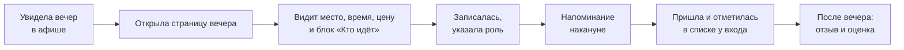

# Требования — «Вечера»

Рабочее название: платформа городских вечеров — афиша, запись и обратная связь.
Категории: танцевальные вечера (бачата, сальса, меренге), стэндап, квизы, концерты,
настольные игры. Первый и самый проработанный сценарий — танцевальные вечера:
у них собственная логика ролей, которой нет у других категорий.

## Предметная область

### Проверка домена по четырём требованиям

| Требование | Проверка | Итог |
| --- | --- | --- |
| 2–3 ограниченных контекста | Вечера и заведения · Записи и посещаемость · Отзывы и репутация · Уведомления | ✅ четыре |
| Внешняя интеграция | Уведомления (email/push), карты, платёжный шлюз (перспектива) | ✅ |
| Пользовательский интерфейс | Афиша и страница вечера для посетителя, панель организатора | ✅ |
| Нетривиальные данные | Вечера разных категорий, записи со статусами (подтверждение явки, неявки), роли, отзывы, рейтинги, фотоотчёты, история посещаемости | ✅ |

**Вывод**: домен проходит.

## Постановка проблемы

> Танцору в моём городе нужно состоять в 4 пабликах ВК, чтобы узнать, где сегодня бачата.

**Что**: городские вечера — танцы, стэндап, квизы — живут в ВК-пабликах и чатах.
Информация размазана по источникам, запись — переписка с организатором в личке,
состав участников не виден никому до самого вечера, а после вечера всё исчезает:
ни отзывов, ни фото, ни понимания, стоит ли идти в следующий раз.

**Для кого**: посетители городских вечеров и организаторы-энтузиасты, которые проводят
вечера в барах и ресторанах и ведут всю запись вручную, «на коленке».

**Зачем**: посетитель видит все вечера в одной афише, записывается без переписки
и видит, кто ещё идёт; организатор заранее видит список и состав, а после вечера
получает отзывы и фотоотчёт — витрину для следующих вечеров.

**Как измерим успех**: доля записей, оформленных без участия организатора; доля вечеров,
собравших отзывы; для танцевальных вечеров — число вечеров с балансом ролей
не хуже [2:1 — порог уточнить у студий].

## Персоны

### Персона: Постоянная танцорка (ведомая)

**Роль и контекст**: работает, танцует бачату и сальсу 2–3 раза в неделю, ходит на все
социальные вечеринки города.

**Цель**: знать заранее, где вечер, видеть, кто ещё идёт, и не приехать на мёртвый танцпол.

**Как решает задачу сейчас**: состоит в четырёх пабликах ВК, мониторит посты вручную,
вечером накануне пишет организатору «кто идёт?».

**Боли**:

- узнаёт о вечере поздно — пост выходит накануне
- не видит состав и баланс ролей до прихода
- на месте может оказаться 15 ведомых на 4 ведущих — вечер испорчен
- отменить запись можно только неловкой перепиской
- после вечера не остаётся следа: ни отзывов, ни фото, через месяц и не вспомнит, какой вечер был

**Что важно**: увидеть вечер и состав за минуту; записаться и отменить без переписки;
напоминание накануне; отзывы и фото после.

### Персона: Организатор вечеров

**Роль и контекст**: фанат своего дела, проводит 1–2 танцевальных вечера в месяц в баре,
изредка — стэндап или квиз в том же заведении. Совмещает с основной работой, всё
делает сам.

**Цель**: собрать полный зал без ручной работы и спасти состав вечера.

**Как решает задачу сейчас**: пост в ВК + чат + таблица, вручную считает запись,
отвечает на одни и те же вопросы в личке.

**Боли**:

- ручной подсчёт записавшихся
- состав и перекос ролей обнаруживаются только на месте
- одни и те же вопросы в личке вместо работы
- владельцу бара нечего показать: посещаемость нигде не фиксируется
- о прошедшем вечере не остаётся следа — каждое следующее собирается с нуля

**Что важно**: список записавшихся собирается сам и виден всем; состав виден заранее;
инструмент выправления баланса до вечера; отзывы и фотоотчёт как витрина; цифры
посещаемости для заведения.

## Путь пользователя

Персона: Постоянная танцорка
Сценарий: записаться на вечер

1. **Увидела вечер** — в единой афише города, не в четырёх пабликах
2. **Открыла страницу вечера** — место, время, цена, программа
3. **Оценила состав** — блок «Кто идёт»: кто записался; у танцевальных — роли
4. **Записалась** — на танцевальный вечер с указанием роли, без переписки
5. **Получила напоминание** — накануне вечером (с шагом подтверждения — v1.1)
6. **Пришла и отметилась** — имя в списке у организатора
7. **Оставила отзыв** — оценка и впечатление после вечера

Отдельный сценарий «отмена»: планы изменились → открыла запись → отменила → место
и блок «Кто идёт» обновились сразу.

## Минимально жизнеспособный продукт

Входит:

- Единая афиша вечеров города с категориями (танцы, стэндап, квизы)
- Страница вечера: место, время, цена, программа
- Запись на вечер; для танцевальных — с указанием роли (ведущий / ведомая)
- Публичный блок «Кто идёт»: список записавшихся, у танцевальных — с ролями
- Видимый баланс ролей (танцевальные вечера)
- Динамическая цена для дефицитной роли — расчёт и отображение (оплата на месте)
- Список на входе для организатора: отметка пришедших и неявок
- Отмена своей записи
- Отзывы и оценка вечера — только от отметившихся на входе

Критерий: посетитель проходит сценарий «увидела → записалась → увидела, кто идёт →
пришла → отметилась → оставила отзыв» без единого сообщения организатору;
организатор видит список, отметки и неявки без ручного подсчёта.

Принцип: система не существует на самом мероприятии. Всё взаимодействие — до входа
и после выхода. На самом вечере продукта нет.

## Вне области охвата этого семестра

| Не делаем | Почему |
| --- | --- |
| Онлайн-оплата | Требует договора с платёжным шлюзом; для проверки гипотезы достаточно оплаты на месте |
| Мобильное приложение | Веб-приложение закрывает сценарий (подтверждено преподавателем) |
| Цифровой инвайт на танец | Нарушает принцип «на мероприятии продукта не существует»; выходит за рамки семестра |
| Запросы диджею | Удобство, а не необходимость для проверки гипотезы |
| «Сохранить танец» (история партнёрств) | Требует накопленной истории посещений; на старте данных нет |
| Рекомендации и подборки вечеров | Требуют накопленных данных; на старте их нет |
| Несколько городов | Усложняет модель и афишу, не влияет на проверяемую гипотезу |
