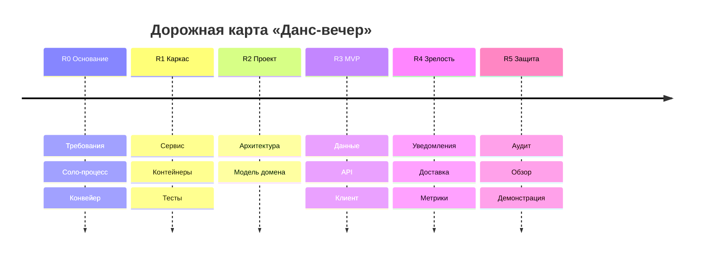

# Дорожная карта — «Данс-вечер»

Горизонт — семестр. Вехи привязаны к модулям курса; внутри вех точных дат нет
намеренно: фактическое расписание работ ведётся в диаграмме Ганта (gantt.md).

| Веха | Модули | Что будет готово |
|---|---|---|
| **R0. Основание** | М01–М02 | Требования, соло-процесс, репозиторий, конвейер проверок |
| **R1. Каркас** | М03–М04 | Работающий сервис, окружение в контейнерах, первые тесты |
| **R2. Проект** | М05–М08 | NFR, диаграммы, архитектурные решения, модель домена: вечера, записи, роли, цены |
| **R3. MVP** | М09–М11 | Данные и миграции, API афиши и записи, клиентские сценарии, стратегия тестирования |
| **R4. Зрелость** | М12–М14 | Асинхронный сценарий (уведомления и напоминания), доставка, наблюдаемость |
| **R5. Защита** | М15–М17 | Клиентское приложение, аудит, архитектурный обзор, демонстрация |

Ключевая точка — R3: к концу М11 сквозной сценарий
«опубликовал вечер → записался → отменил запись» проходит целиком.

