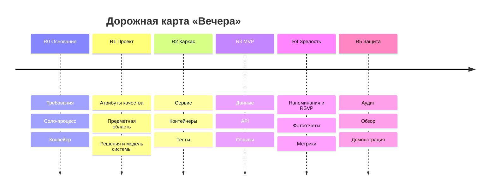

# Дорожная карта — «Вечера»

Горизонт — семестр. Вехи привязаны к модулям курса; внутри вех точных дат нет
намеренно: фактическое расписание работ ведётся в диаграмме Ганта (gantt.md).

| Веха | Модули | Что будет готово |
| --- | --- | --- |
| **R0. Основание** | М01–М02 | Требования, соло-процесс, репозиторий, конвейер проверок |
| **R1. Проект** | М03–М06 | Требования и атрибуты качества, модель предметной области, архитектурные решения, модель системы |
| **R2. Каркас** | М07–М08 | Работающий сервис, окружение в контейнерах, первые тесты |
| **R3. MVP** | М09–М11 | Данные и миграции, API афиши, записи и отзывов, клиентские сценарии, стратегия тестирования |
| **R4. Зрелость** | М12–М14 | Асинхронные сценарии: напоминания и подтверждение явки; медиа: фотоотчёты; доставка, наблюдаемость |
| **R5. Защита** | М15–М17 | Клиентское приложение, аудит, архитектурный обзор, демонстрация |

Порядок вех следует программе курса: проектирование (R1) завершается **до
первой строки кода** — каркас (R2) и реализация (R3) пишутся по документам
проекта. Привязка вех к модулям обновлена по программе ЛР 2, изменение
зафиксировано в журнале изменений, версия 0.3.0.

Ключевая точка — R3: к концу М11 сквозной сценарий «опубликовал вечер → записался →
отметился → оставил отзыв» проходит целиком.

